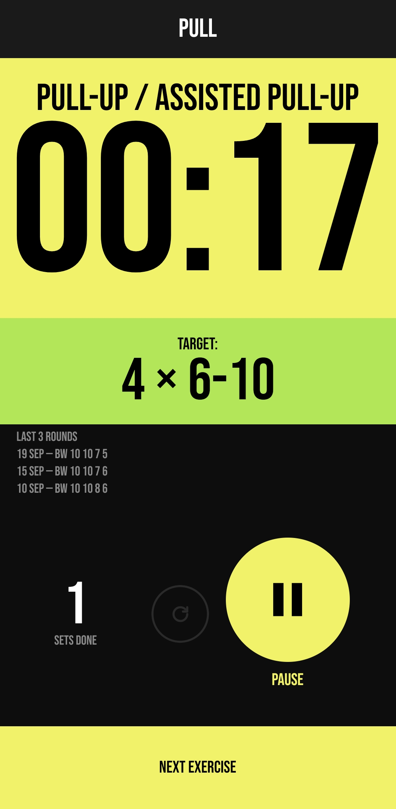
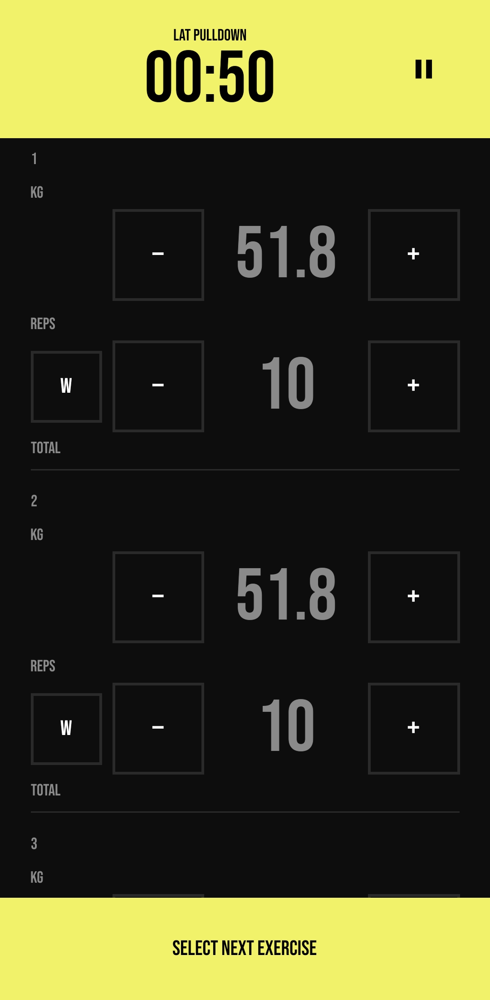
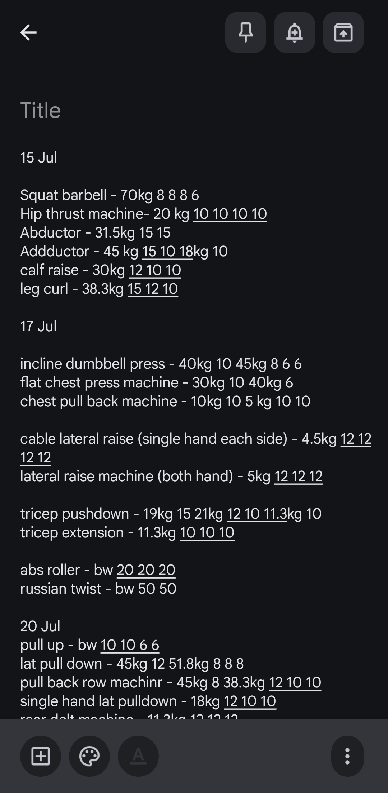
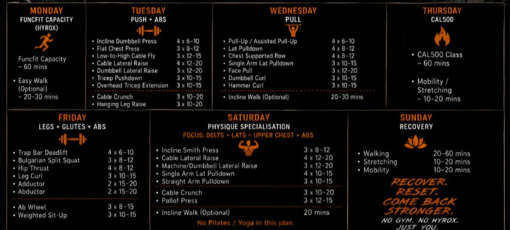
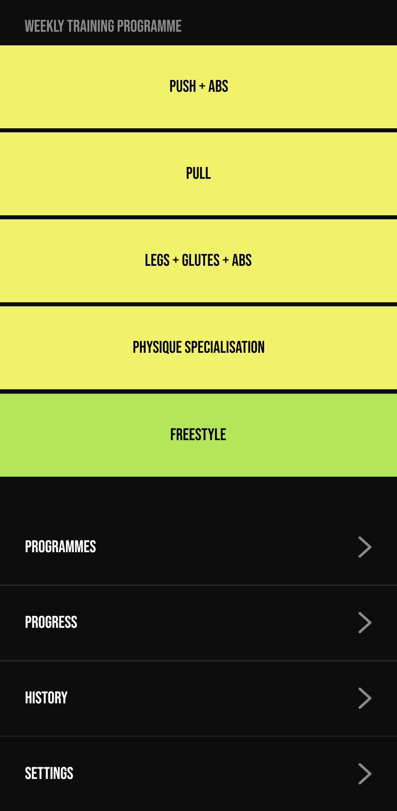

# REP: a lifting log that keeps you off your phone

Pick up your phone to log a set, and there is a good chance you end up scrolling Instagram or messages while your one minute rest turns into five. That happened to me in almost every session, and I suspect many gym-goers know the feeling. REP is an offline Android lifting log built to avoid it. It runs an entire gym session on a single screen that can be read at a glance from across a bench, so the phone stays on its stand between sets and out of your hand.

It is also a personal project I use to learn vibe coding: building real software by directing an AI coding agent through written requirements, rules and testing, rather than writing the code myself.

<p align="center">
  
  
</p>

## The problem

Before REP, every session depended on three separate tools:

| Tool | What I used it for |
|---|---|
| Google Keep | Recording weights and reps as free text in one running note, with a dated entry for each session |
| Timer Plus | A stopwatch left running between sets, flashing the screen every 30 seconds so I would notice my rest was over |
| A screenshot in WhatsApp | My training programme, planned digitally and saved as an image for quick access |

<table>
  <tr>
    <td align="center"><br><sub>Google Keep log</sub></td>
    <td align="center"><br><sub>Timer Plus stopwatch</sub></td>
    <td align="center"><br><sub>Programme screenshot in WhatsApp</sub></td>
  </tr>
</table>

This setup worked well enough to survive for months, but it had a cost I could not ignore. Logging each set meant picking up the phone, opening Keep, finding last week's numbers, typing in today's, and switching back to the timer. Once the phone was in my hand, it was easy to drift into other apps, and a planned 60 second rest would stretch well beyond that. Checking the programme added another detour: leaving the log, finding the image in WhatsApp and zooming in on it while standing at the rack. Occasionally Android would also close Keep or the timer in the background, and part of the session would be lost.

## Why REP works differently

Most workout logging apps I have tried assume you will interact with the phone throughout the session. You open the exercise, enter the weight and reps, and save. Many also expect a tap to start the rest timer and another to stop it, which means handling the phone both before and after every rest. For me that interaction was the problem itself, because every time I held the phone I risked losing focus on the workout.

REP is designed around the opposite assumption. The phone sits on a stand and is mostly looked at, not handled.

* **Logging a set is one tap.** After each set I tap the sets-done counter and put the phone down. When I move to the next exercise, REP shows that many set rows already filled in with last session's weights and reps. If I matched them there is nothing to type; if not, I adjust only the rows that changed.
* **The rest cue needs no input.** I start the stopwatch once and leave it running for the whole session. It flashes the full screen every 30 seconds, the same cue I relied on in Timer Plus, so two flashes after a set means roughly a minute of rest. This is less precise than a countdown to the second, and that is a deliberate trade. At my level of training, resting 60 or 70 seconds makes little difference. Picking up the phone and resting for five minutes because I started scrolling makes a large one, and that was what kept happening before.
* **The programme lives inside the session.** Today's exercises are offered in order with their targets, and the workout screen shows my last three rounds of the current exercise, so there is no need to open WhatsApp or Keep.
* **Nothing can be lost.** The screen stays on for the whole workout, and every tap is written to the phone's storage immediately. There is no save button.

<table>
  <tr>
    <td align="center"><br><sub>Home: pick today's training day</sub></td>
    <td align="center"><br><sub>Workout: stopwatch and targets</sub></td>
    <td align="center"><br><sub>Logging: pre-filled from last session</sub></td>
  </tr>
</table>

### Why not a smartwatch?

I do own one, but it has never fitted how I train. Keeping it charged is one more thing to manage, and I have not been able to get used to the raise-to-wake screen. During a workout it is often off when I actually want to check the time, and it turns on by accident when I do not. A phone on a stand with the screen always on is simpler and more reliable for me.

## How it fits with my planning

```
 Health Claude project                    REP (this repo)

 health check reports                     programme JSON import
 body composition scans  ==> programme ==>   strict validator (tested)
 goals and constraints       (JSON)          templates per training day
                                ^            logging, history, progress
                                |                     |
                                +==== export / progress
```

My health reports, body composition scans and training goals are kept in a separate Claude project, which is where my programmes are written. None of that personal data is included in this repository.

Each programme is exported as a JSON file in a fixed format ([PRD Appendix A](docs/PRD.md)). REP validates the file strictly before importing it, and any error names the affected field in plain language, so an invalid file never reaches the database. REP then runs the sessions, and its history, progress chart and CSV/JSON export inform the next round of planning.

## How it was built

I did not write the code for REP. Claude Code wrote it, one session at a time. My role was to write the product requirements, design specification and build plan, define the rules the code had to follow, and test every build on my phone during real workouts. After each gym session I wrote a list of problems, and each list became the brief for the next fix session.

Because I was learning vibe coding through this project, I treated the documents as a core part of the repository. They show the process as much as the app does.

| File | Purpose |
|---|---|
| [`docs/PRD.md`](docs/PRD.md) | Product requirements: problem, goals, features and data model |
| [`docs/DESIGN-SPEC.md`](docs/DESIGN-SPEC.md) | Visual rules written precisely enough for an agent to follow without guessing |
| [`docs/BUILD-SESSIONS.md`](docs/BUILD-SESSIONS.md), [`docs/REBUILD-SESSIONS.md`](docs/REBUILD-SESSIONS.md) | The build divided into small sessions, one per context window, each ending with a pass or fail check |
| [`CLAUDE.md`](CLAUDE.md) | Rules the agent may not break: no save button, soft deletes only, weights always stored in kg, all database access through one layer, and every exercise locked to per side, total or bodyweight |
| [`docs/PROGRESS.md`](docs/PROGRESS.md) | A dated log of what each session delivered and where it departed from the brief |

Two outcomes stood out. First, the rules are enforced by unit tests rather than documentation alone. The app will never assume a bar weight or a plate count, for example; it asks. Second, the first version of the interface was functional but difficult to read in the middle of a set, so I wrote a stricter design specification and rebuilt the screens over sessions R0 to R7. The data layer was not changed during that rebuild.

## Features

* **Workout screen:** large count-up stopwatch, full-screen flash every 30 seconds (interval adjustable), last three rounds of the current exercise, screen kept on throughout
* **Set logging:** large steppers, warm-up and drop sets, values pre-filled from the last session, and the load type with its calculated total always visible
* **Plate calculator:** plates per side for a target weight, based on the gym's actual plate inventory. If a weight cannot be made exactly, it shows the closest achievable load and the difference instead of rounding silently
* **Programmes:** import from JSON, set one as active, swap exercises
* **Google Keep import:** a tested parser that converts free-text notes (`22.5kg 10 8 7 5 12.5kg 10`) into structured sets and flags anything it cannot read instead of discarding it
* **History and progress:** per-exercise chart of top working set weight and reps, date range filters, workout deletion
* **Export and backup:** CSV/JSON export and automatic database backups. Imports only add data and never overwrite existing records
* **Rest notifications** when the app is running in the background (development build only; Expo Go does not support them)

## Stack

React Native and Expo (TypeScript, strict), SQLite via expo-sqlite and Drizzle ORM, Zustand, expo-router, Jest.

No backend, no accounts, no analytics and no network calls.

```
src/
  app/                 screens (expo-router)
  components/
  data/
    schema.ts          Drizzle schema
    repositories/      all database access goes through here
  domain/              pure, unit tested logic: plate maths, Keep parser, programme validator
  state/               Zustand stores
  theme.ts, strings.ts
```

## Running it

```bash
npm install
npx expo start        # scan with Expo Go, or use a development build
npm run typecheck
npm run test          # 33 suites, 165 tests
```

## Credits

REP's visual design (full-width colour blocks, heavy condensed numerals and a black on yellow timer) is inspired by [*Timer Plus - Workouts Timer*](https://play.google.com/store/apps/details?id=com.vgfit.timerplus) by Uniqo Lab. This was the interval timer I used between sets before building REP. Its readability during a workout is the reason REP looks the way it does. The Timer Plus screenshot above is included only to illustrate my previous setup. REP is an independent, non-commercial personal project and is not affiliated with or endorsed by Uniqo Lab. No Timer Plus code or assets are included in the app.

## License

[MIT](LICENSE) © 2026 Derrick Chiang
