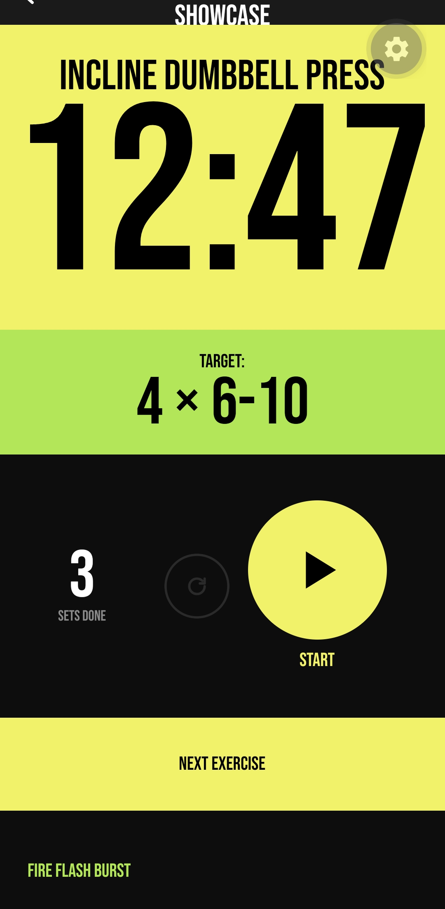
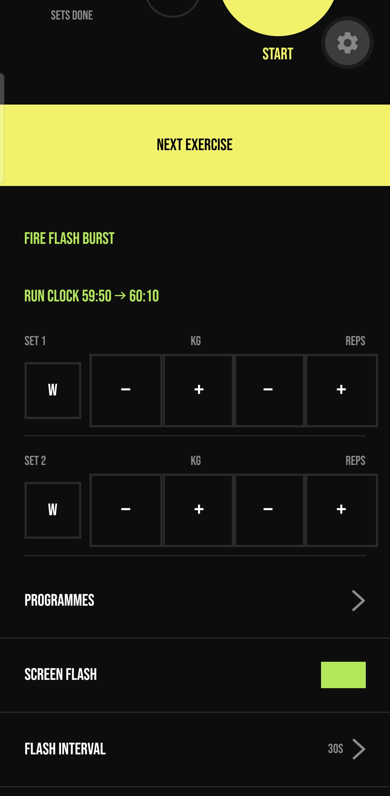

# REP

A zero-friction, offline Android lifting log. It replaced the three separate tools I used to run every gym session (a notes app, a stopwatch left running between sets, and a paper programme) with one screen I can read at a glance from across a bench.

**Built with AI, directed by me.** I wrote the product requirements, design spec and build plan, and set the rules the code had to follow. [Claude Code](https://claude.com/claude-code) wrote the code one session at a time against those documents. I tested every build on my phone in real workouts and sent the problems back as fix lists.

<p align="center">
  
  &nbsp;&nbsp;
  
</p>

## Why it exists

Before REP, a session meant switching between a note of past weights, a timer app flashing every 30 seconds during rest, and a printed programme. Now and then Android killed one of those apps and the session was gone. REP puts all three on one screen, stores each tap on the phone the moment it happens, and never needs a network.

## How the AI workflow fits together

```
 Health Claude project                     REP (this repo)
 ───────────────────────                   ─────────────────────────────────
 health check reports  ─┐                  programme JSON import
 body composition scans ├─► training  ───► ├─ strict schema validator (tested)
 goals & constraints   ─┘   programme      ├─ templates per training day
                            (JSON)         └─ logging, history, progress
                               ▲                          │
                               └──── export / progress ───┘
```

1. **Planning.** A separate Claude project holds my health and body composition data and writes training programmes for me. That personal data stays there. None of it is in this repo.
2. **Handoff.** Programmes come out as JSON in a documented schema ([PRD Appendix A](docs/PRD.md)). REP validates the file strictly and names every rejected field in plain language, so a bad file never reaches the database.
3. **Execution.** REP runs the session: stopwatch, rest cue, set logging, and pre-filled values from last time.
4. **Feedback.** History, the per-exercise progress chart and CSV/JSON export give me the numbers for the next round of planning.

## How it was built

This repo is meant to show a repeatable way to build software with an AI coding agent, not just the finished app.

| Artifact | Role |
|---|---|
| [`docs/PRD.md`](docs/PRD.md) | Product requirements: problem, goals, functional requirements, data model |
| [`docs/DESIGN-SPEC.md`](docs/DESIGN-SPEC.md) | Visual rules written so an agent can follow them without guessing |
| [`docs/BUILD-SESSIONS.md`](docs/BUILD-SESSIONS.md), [`docs/REBUILD-SESSIONS.md`](docs/REBUILD-SESSIONS.md) | The build split into small sessions, one per AI context window, each ending with a pass/fail check |
| [`CLAUDE.md`](CLAUDE.md) | Rules the agent may never break: no Save button (every tap is written to the database immediately), soft deletes only, weights always stored in kg, all database access in one layer, every exercise has a fixed per-side / total / bodyweight load type |
| [`docs/PROGRESS.md`](docs/PROGRESS.md) | Dated log of what each session shipped and where it strayed from the brief |

A few things that went well:
- **The rules held.** They are backed by unit tests, not just written down. For example, the app never guesses a bar weight or a plate count; it asks.
- **The UI was redone once.** The first UI worked but was hard to read mid-set. I wrote a stricter design spec and rebuilt the screens in sessions R0 to R7. The data layer wasn't touched.
- **Real use drove the fixes.** After every gym session I wrote a fix list, and each one became a follow-up session.

## Features

- **Live workout screen:** a large count-up stopwatch, a full-screen flash every 30 seconds as a rest cue, and the screen stays on during a workout
- **Set logging:** large steppers, warm-up and drop sets, values pre-filled from last session, and the load type plus calculated total always visible
- **Plate calculator:** plates per side for a target weight from your own plate inventory; shows the closest achievable load instead of rounding silently
- **Programmes:** import from JSON, mark one as active, swap exercises
- **Google Keep import:** a tested parser turns free-text gym notes (`22.5kg 10 8 7 5 12.5kg 10`) into structured sets, and flags anything it can't read instead of dropping it
- **History and progress:** per-exercise chart of top working-set weight and reps, date-range filters, delete a workout
- **Export and backup:** CSV/JSON export and automatic database backups; imports only ever add data, never overwrite
- **Rest notifications** when the app is in the background

## Stack

React Native + Expo (TypeScript, strict) · SQLite via `expo-sqlite` + Drizzle ORM · Zustand · expo-router · Jest

No backend, no accounts, no analytics, no network calls.

```
src/
  app/                 screens (expo-router)
  components/
  data/
    schema.ts          Drizzle schema
    repositories/      all database access goes through here
  domain/              pure, unit-tested logic: plate maths, Keep parser, programme validator
  state/               Zustand stores
  theme.ts, strings.ts
```

## Running it

```bash
npm install
npx expo start        # scan with Expo Go, or use a development build
npm run typecheck
npm run test          # 33 suites, 165 tests
```

## Credits

The visual design (full-width colour blocks, heavy condensed numerals, black-on-yellow timer) is inspired by **[Timer Plus](https://play.google.com/store/apps/details?id=com.vgfit.timerplus) by VGFIT LLC**, the interval timer I relied on between sets before building REP. Its readability mid-workout is why REP looks the way it does. REP is an independent, non-commercial personal project and is not affiliated with or endorsed by VGFIT LLC. No Timer Plus code or assets are included.

## License

[MIT](LICENSE) © 2026 Derrick Chiang
